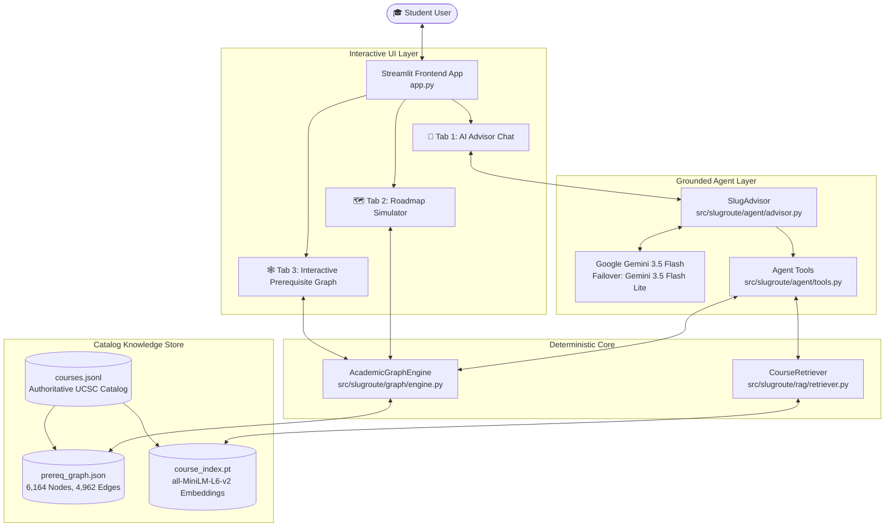

# 🐌 SlugRoute | UCSC AI Academic Advisor

> **Grounded, hallucination-free academic degree planning and prerequisite navigation for UC Santa Cruz students.**  
> *Built with Google Gemini, NetworkX DAG Scheduling, SentenceTransformers RAG, and Streamlit for UCSC DevFest '26.*

[](https://www.python.org/)
[](https://pypi.org/project/google-genai/)
[](https://aistudio.google.com/)
[](https://streamlit.io/)
[](https://networkx.org/)
[](https://catalog.ucsc.edu/)

---

## 📌 Overview

Academic advising in university environments is fraught with complex, nested requirements. Large Language Models (LLMs) used out-of-the-box frequently **hallucinate prerequisites**, suggest illegal course sequences, or overlook degree constraints.

**SlugRoute** solves this by pairing Google Gemini with a **deterministic graph engine** and **local semantic vector retrieval**:
* **Deterministic Logic**: Prerequisite validations and multi-quarter schedules are calculated strictly by graph traversal over a verified Directed Acyclic Graph (DAG) built from official catalog data.
* **Semantic Search**: Fast, local vector embeddings locate courses by topic, subfield, or General Education (GE) code without relying on cloud search latencies.
* **Grounded AI Agent**: Google Gemini acts as an intelligent conversational layer, utilizing native tool calling to ground every recommendation in catalog truth.
* **Auto-Linkified Catalog**: All courses mentioned by the AI advisor or displayed on roadmap cards are automatically mapped to verified, clickable [catalog.ucsc.edu](https://catalog.ucsc.edu) URLs.

---

## 🏛️ System Architecture



---

## ✅ Key Features

### 1. 💬 Grounded AI Academic Advisor
* **Multi-Turn Chat**: Natural language advising contextualized with the student's declared major, completed courses, and quarterly credit limits.
* **Native Tool Calling**: Gemini autonomously queries catalog search, inspects detailed descriptions, verifies eligibility against the DAG, and generates roadmaps.
* **Automatic Failover & Resilience**: Automatically fails over from `gemini-3.5-flash` to `gemini-3.5-flash-lite` if rate limits occur, preserving full conversation history.
* **Zero-Crash Offline Engine**: Deterministic fallback mechanism queries local graph data directly if cloud connectivity is interrupted.

### 2. 🗺️ Degree Roadmap & Simulator
* **Topological Scheduling**: Sequentially plans prerequisites from entry placement courses (`MATH 19A`, `CSE 20`) through advanced electives using topological DAG sorts.
* **Major Profiles**: Tailored preference logic for majors (e.g., Computer Science B.S. vs. Bioinformatics B.S.) to break prerequisite `OR` choices (e.g., selecting `CSE 13S` over `ECE 13` for CS).
* **Credit Load Balancing**: Distributes courses across quarters honoring standard full-time limits (12–22 credits/quarter).

### 3. 🕸️ Interactive Prerequisite Network Graph
* **Visual Dependency Chains**: Inspect any course's prerequisite graph rendered with physics simulation via PyVis.
* **Depth Slider**: Filter between direct prerequisites (Depth 1), intermediate prerequisites (Depth 2, 3), or the entire ancestral chain.
* **Responsive Centering**: Built-in `ResizeObserver` automatically fits and centers the graph upon switching tabs.
* **UCSC Color Coding**: 🟡 Target Course (Slug Gold), 🟢 Completed Courses (Green), 🔵 Pending Prerequisites (UCSC Blue).

### 4. 🔗 Automatic Catalog Linkification
* **Zero Hallucinated Links**: Course codes in responses (e.g., `CSE 101`, `CSE 142`, `MATH 19B`) are deterministically matched against the graph and rendered as clickable links to their official UCSC General Catalog pages.
* **Code-Fence Aware**: Leaves code blocks and JSON payloads untouched while enriching standard markdown prose.

---

## ⚡ Google Technologies Used

| Product | Role in SlugRoute |
| :--- | :--- |
| **Gemini 3.5 Flash** | Primary reasoning engine for multi-step student advisory, contextual synthesis, and plan generation. |
| **Gemini 3.5 Flash Lite** | High-availability failover model ensuring zero downtime under API rate limiting. |
| **Google GenAI SDK** (`google-genai`) | Official next-generation Python SDK managing multi-turn chat sessions and automatic function calling (AFC). |
| **Google AI Studio** | Developer platform for API key provisioning, system prompt configuration, and quota management. |

---

## 📁 Repository Structure

```text
slug-dev-fest26/
├── assets/                           # Branding & visual assets
│   ├── banana_slug.png               # High-res authentic UCSC Banana Slug icon
│   └── banana_slug.svg               # Vector Banana Slug artwork
├── data/
│   ├── raw/
│   │   └── courses.jsonl             # 6,164 scraped UCSC catalog courses
│   └── processed/
│       ├── course_index.pt           # PyTorch vector embeddings (16.5 MB)
│       └── prereq_graph.json         # NetworkX DAG node-link graph
├── data_pipeline/                    # Data ingestion & ETL pipeline
│   ├── 01_scrape_courses.py          # Concurrent catalog web scraper
│   ├── 02_build_embeddings.py        # SentenceTransformer vectorizer
│   └── 03_build_graph.py             # DNF/CNF parser & cycle-breaking DAG builder
├── src/
│   └── slugroute/                    # Core application package
│       ├── agent/
│       │   ├── advisor.py            # Gemini agent wrapper & failover logic
│       │   └── tools.py              # 4 Grounded tools for Gemini function calling
│       ├── graph/
│       │   └── engine.py             # AcademicGraphEngine, CNF evaluator, sequencer
│       ├── rag/
│       │   └── retriever.py          # Vector search engine & exact lookup
│       └── config.py                 # Paths, constants, and environment secrets
├── app.py                            # Streamlit web application
├── pyproject.toml                    # UV project configuration & dependencies
├── test_graph_integrity.py           # DAG integrity & prerequisite logic regression suite
├── test_engine.py                    # Graph sequencing verification
├── test_retriever.py                 # Semantic search verification
├── test_tools.py                     # Agent tool validation suite
├── test_models.py                    # Gemini API & model availability diagnostic
├── diagnose_api.py                   # Latency and model responsiveness benchmark
└── find_demo_courses.py              # Utility to find clean demo candidate courses
```

---

## 🚀 Quickstart Guide

### Prerequisites
* **Python 3.11**
* **[uv](https://docs.astral.sh/uv/)** (recommended fast Python package manager)
* A **Google Gemini API Key** from [Google AI Studio](https://aistudio.google.com/)

### 1. Clone the Repository
```bash
git clone https://github.com/your-username/slug-dev-fest26.git
cd slug-dev-fest26
```

### 2. Install Dependencies
Using `uv`:
```bash
uv sync
```
*(Alternatively, using standard pip: `pip install -e .`)*

### 3. Configure Environment Variables
Copy the example environment file and add your Google Gemini API key:
```bash
cp .env.example .env
```
Edit `.env`:
```env
GEMINI_API_KEY=your_actual_gemini_api_key_here
```

### 4. Run the Streamlit Application
```bash
uv run streamlit run app.py
```
Open your browser at `http://localhost:8501`.

---

## 🧪 Testing & Validation

The codebase includes comprehensive test suites ensuring data integrity and model connectivity:

* **Prerequisite DAG & Graph Integrity**:
  ```bash
  uv run python test_graph_integrity.py
  ```
  *Validates strict DAG acyclicity, multi-track DNF evaluations, and quarter bounds.*

* **Semantic Course Retrieval**:
  ```bash
  uv run python test_retriever.py
  ```

* **Agent Grounding Tools**:
  ```bash
  uv run python test_tools.py
  ```

* **Gemini Model Availability Diagnostic**:
  ```bash
  uv run python test_models.py
  ```

* **Code Linting & Formatting**:
  ```bash
  uv run flake8
  ```

---

## 📊 Data Pipeline Reproduction

If you wish to re-scrape the UCSC catalog or re-compute the embeddings and graph from scratch:

```bash
# 1. Scrape all 87 department pages (6,164 courses)
uv run python data_pipeline/01_scrape_courses.py

# 2. Build MiniLM dense vector index
uv run python data_pipeline/02_build_embeddings.py

# 3. Parse DNF/CNF prerequisites and build DAG
uv run python data_pipeline/03_build_graph.py
```

---

## 🎓 About

Created for **DevFest 2026** at the **University of California, Santa Cruz (UCSC)**.